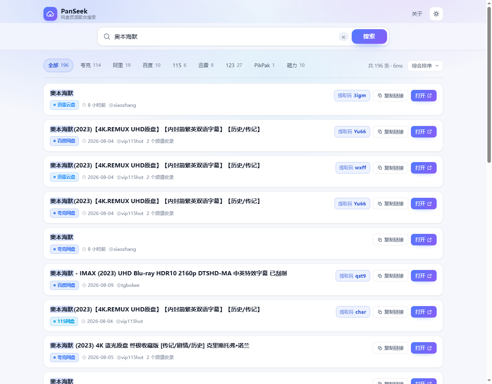
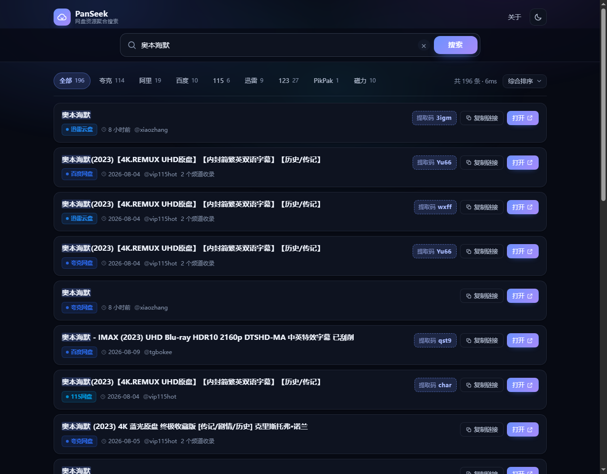

# PanSeek · 网盘资源聚合搜索

一个搜索框，搜遍全网网盘。把多个公开资源频道的结果聚合成一页，按网盘类型分类、去重、排序，支持提取码一键复制。

> 思路参考知乎文章 [《PanHub：用一个搜索框搜遍阿里云盘、夸克、百度网盘、115、迅雷等热门网盘资源》](https://zhuanlan.zhihu.com/p/1950479440715966166)。
> 这里是一个**零依赖、可自托管、数据源可插拔**的轻量实现：后端只有一个 Node 进程，没有数据库、不需要 `npm install`、前端也不需要构建。

| 搜索结果（浅色） | 搜索结果（深色） |
| --- | --- |
|  |  |

| 首页 | 移动端 |
| --- | --- |
|  |  |

```
┌─────────────┐   并发请求   ┌──────────────┐   去重 / 打分 / 排序   ┌──────────────┐
│ 浏览器 SPA  │ ───────────▶ │ PanSeek 服务 │ ────────────────────▶ │ 上游数据源    │
│ 搜索/筛选   │ ◀─────────── │ 缓存 + 限流  │ ◀──────────────────── │ 多频道聚合    │
└─────────────┘   JSON      └──────────────┘      统一结构          └──────────────┘
```

## 功能

- **聚合搜索**：夸克、阿里云盘、百度网盘、115、迅雷、UC、天翼、移动云盘、123、PikPak、蓝奏云、微云，共 12 种网盘 + 磁力
- **两路抽取**：既用上游已分好类的合并结果，也从频道原始消息正文里正则二次抓取链接，避免漏掉没进合并表的资源
- **去重合并**：同一网盘同一路径视为同一资源，补全缺失的提取码 / 体积 / 时间，并记录“2 个频道收录”
- **智能排序**：标题命中程度 + 新近度 + 是否有提取码/体积 + 多频道收录加权；可切「相关度 / 最新发布」
- **提取码**：自动从链接参数或正文里解析（会处理“提取码：8888https://…”这种粘连写法），点击即复制
- **体验**：骨架屏、空状态推荐词、搜索历史、热门词、深浅色主题、移动端适配、`/` 快捷聚焦、URL 可分享（`?kw=&type=&sort=&theme=`）
- **工程**：TTL + LRU 缓存、并发请求合并、单 IP 限流、上游故障转移、过期缓存兜底、离线样例兜底、gzip、ETag、CSP 等安全头
- **0 依赖**：`package.json` 没有 `dependencies`，克隆即跑

## 快速开始

需要 Node.js ≥ 20（推荐 22）。

```bash
cd panseek
npm start                 # 等价于 node server/index.mjs
# → http://127.0.0.1:8787
```

换端口 / 对外监听：

```bash
PORT=8080 HOST=0.0.0.0 npm start
```

跑测试（42 个用例：单元测试 + 真实 HTTP 端到端）：

```bash
npm test
```

## 配置

全部通过环境变量控制，也可以写在 `.env` 里由容器注入。

| 变量 | 默认值 | 说明 |
| --- | --- | --- |
| `HOST` | `127.0.0.1` | 监听地址，公网部署改 `0.0.0.0` |
| `PORT` | `8787` | 监听端口 |
| `PANSOU_ENDPOINTS` | `https://so.252035.xyz/api/search` | 上游接口，逗号分隔多个做故障转移 |
| `UPSTREAM_TIMEOUT_MS` | `15000` | 单次上游请求超时 |
| `CACHE_TTL_MS` | `300000` | 结果缓存时长（过期数据还会保留 24h 用于兜底） |
| `CACHE_MAX` | `400` | 缓存关键词条数上限 |
| `RATE_LIMIT_MAX` | `40` | 每 IP 每窗口请求数 |
| `RATE_LIMIT_WINDOW_MS` | `60000` | 限流窗口 |
| `MAX_RESULTS` | `400` | 单次返回结果上限 |
| `DEMO_FALLBACK` | `true` | 上游全挂时是否用离线样例兜底 |
| `TRUST_PROXY` | `false` | 是否信任 `X-Forwarded-For`（放在 Nginx 后面时开） |
| `HOT_WORDS` | 内置词表 | 首页热门词，逗号分隔 |

## 接口

### `GET /api/search`

| 参数 | 说明 |
| --- | --- |
| `kw` | 关键词，1–80 字符（必填，也接受 `q` / `keyword`） |
| `type` | 网盘类型，如 `quark` / `aliyun` / `baidu` / `pan115` / `xunlei`，默认 `all` |
| `sort` | `default`（综合）/ `relevance`（相关度）/ `latest`（最新） |
| `limit` | 返回条数，默认 400 |

```bash
curl 'http://127.0.0.1:8787/api/search?kw=%E5%A5%A5%E6%9C%AC%E6%B5%B7%E9%BB%98&type=quark&limit=2'
```

```json
{
  "ok": true,
  "kw": "奥本海默",
  "type": "quark",
  "sort": "default",
  "total": 112,
  "elapsedMs": 38,
  "cached": false,
  "demo": false,
  "stale": false,
  "types": [{ "id": "quark", "count": 112 }, { "id": "aliyun", "count": 24 }],
  "items": [
    {
      "id": "1a2b3c",
      "title": "奥本海默(2023)【4K.REMUX UHD原盘】【内封简繁英双语字幕】【历史/传记】",
      "url": "https://pan.quark.cn/s/334310e1c46b",
      "panType": "quark",
      "panName": "夸克网盘",
      "password": "Yu66",
      "size": "40.2GB",
      "datetime": "2024-08-04T03:09:44.000Z",
      "ts": 1707793784000,
      "channel": "vip115hot",
      "channels": ["vip115hot", "tgbokee"],
      "source": "pansou",
      "desc": "",
      "score": 61.4
    }
  ],
  "warnings": [],
  "sources": [{ "id": "pansou", "label": "PanSou 聚合", "ok": true, "ms": 386, "count": 138, "error": "" }],
  "truncated": false
}
```

### `GET /api/meta`

热门词、网盘类型（含品牌色）、排序选项、数据源列表，供前端渲染。

### `GET /api/health`

进程运行时长、缓存命中统计、各数据源状态。可直接用于容器健康检查。

- 业务错误统一返回 `{ "ok": false, "error": { "code": "...", "message": "..." } }`
- `400` 参数不合法 · `429` 触发限流（带 `Retry-After`）· `502` 所有数据源都不可用

## 数据源

默认数据源是公开的 PanSou 兼容接口（`/api/search?kw=xxx&res=all`）。公共实例**会被限流、也会抽风**（实测第一次 6–15s、偶尔超时），所以项目做了三层兜底：

1. 同一关键词 5 分钟缓存 + 并发合并，重复搜索基本是毫秒级；
2. 上游失败时用该关键词的过期缓存（24 小时内），页面提示“以下是上一次成功搜索的缓存结果”；
3. 仍然没有结果就展示内置离线样例（`data/demo.json`，209 条真实抓取数据），页面明确标注并提供「重新检索」。

> 离线样例**不写缓存**：上游一恢复，下一次搜索立刻拿到真实结果。

长期使用建议**自建上游**：把 `PANSOU_ENDPOINTS` 指向自己的实例，或者按下面方式接入新的数据源。

### 接入新的数据源

在 `server/adapters/` 新建文件，实现同样的接口：

```js
// server/adapters/my-source.mjs
import { buildItem } from '../core/normalize.mjs';

export function createMyAdapter({ timeout, fetchImpl = fetch }) {
  return {
    id: 'mine',
    label: '我的资源站',
    async search(kw) {
      const res = await fetchImpl(`https://api.example.com/s?q=${encodeURIComponent(kw)}`, {
        signal: AbortSignal.timeout(timeout),
      });
      const json = await res.json();
      const items = json.data.map((row) =>
        buildItem({ url: row.link, title: row.name, password: row.pwd, datetime: row.time }, { source: 'mine' })
      );
      return { items, endpoint: 'api.example.com', took: 0, total: items.length };
    },
  };
}
```

然后在 `server/adapters/registry.mjs` 里 `adapters.push(createMyAdapter(...))`。并发、超时、去重、打分、缓存、限流都不用再管。

## 目录结构

```
panseek/
├── server/
│   ├── index.mjs            HTTP 服务入口（路由、安全头、静态资源、限流）
│   ├── config.mjs           环境变量配置
│   ├── cache.mjs            TTL + LRU 缓存、过期兜底、请求合并
│   ├── ratelimit.mjs        滑动窗口限流
│   ├── static.mjs           静态资源（ETag / gzip / 路径穿越防护）
│   ├── core/
│   │   ├── normalize.mjs    链接清洗、网盘识别、提取码/体积解析、频道文本抽链接
│   │   ├── rank.mjs         去重、打分、排序、分类计数
│   │   ├── search.mjs       搜索编排（并发、超时、兜底、缓存）
│   │   └── hot.mjs          热门词
│   └── adapters/
│       ├── pansou.mjs       PanSou 兼容接口适配器（双路抽取 + 故障转移 + 重试）
│       ├── demo.mjs         离线样例数据源
│       └── registry.mjs     数据源注册表
├── public/                  前端（原生 ES Module，无构建）
│   ├── index.html
│   ├── app.js
│   └── styles.css
├── data/demo.json           离线样例（209 条，来自真实抓取）
├── docs/                    截图
├── scripts/
│   ├── build-demo.mjs       重新生成离线样例
│   ├── check-upstream.mjs   上游体检（状态码 / 耗时 / 结构）
│   ├── cdp-shot.mjs         用 Chrome DevTools Protocol 截图 + 布局溢出检测
│   └── cdp-check.mjs        前端功能自检（切换筛选 / 加载更多 / 计数一致性）
└── test/                    单元测试 + HTTP 端到端测试
```

## 开发自检

```bash
npm test                                            # 42 个用例
node scripts/check-upstream.mjs --kw 三体            # 上游还好吗？

# 需要一个开着调试端口的 Chrome
chrome --headless=new --remote-debugging-port=9333 --user-data-dir=/tmp/cdp about:blank
node scripts/cdp-shot.mjs --url "http://127.0.0.1:8787/?kw=奥本海默" --out docs/x.png
node scripts/cdp-check.mjs --url "http://127.0.0.1:8787/?kw=奥本海默"
```

`cdp-shot.mjs` 会顺手报告 `scrollWidth` 和最右侧溢出的元素，用来兜住移动端横向滚动这类回归。

## Docker 部署

```bash
docker compose up -d --build
# 或
docker build -t panseek .
docker run -d --name panseek -p 8787:8787 -e TRUST_PROXY=0 panseek
```

Nginx 反代示例：

```nginx
location / {
    proxy_pass http://127.0.0.1:8787;
    proxy_set_header Host $host;
    proxy_set_header X-Forwarded-For $proxy_add_x_forwarded_for;
    proxy_read_timeout 60s;
}
```

部署到公网时记得：开 `TRUST_PROXY=1`（在反代后面）、给 `/api/search` 再加一层网关限流、并保留页脚的免责声明。

## 说明与边界

- 本站**只做公开链接的检索与聚合**，不存储、不上传、不代理、不破解任何文件；所有链接指向第三方网盘，版权归原发布者所有。
- 数据质量取决于上游频道：标题脏、时间缺失、链接失效都很常见。项目做了清洗（去链接、补全标题、提取码粘连修正），但无法保证 100% 准确。
- 公共上游随时可能停服或改接口；遇到问题时先看 `/api/health` 和页面顶部的告警条，或跑 `scripts/check-upstream.mjs`。
- 请勿将本项目用于商业分发或规避版权，下载后请于 24 小时内删除。

## License

MIT
